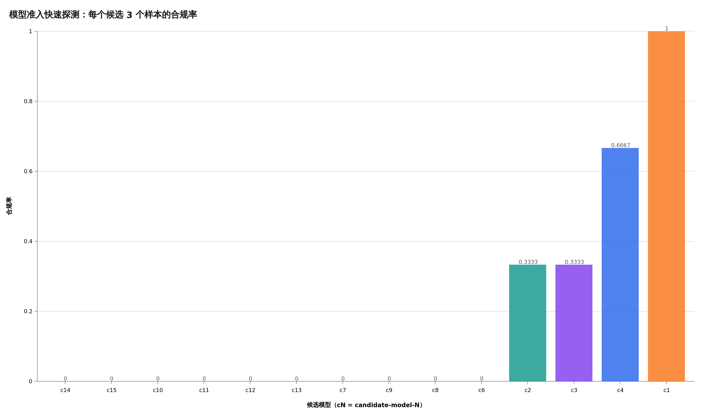

# 模型准入筛选

日期：2026-11-14（Asia/Shanghai）

命令：`npm run model:qualify`

目的：在正式 60 次实验前，用小样本筛选真实模型是否能满足严格四选一结构化契约。

## 门槛

- 每个候选至少 10 个样本；
- 合规率 ≥ 0.9；
- 合规样本延迟中位数 ≤ 5000 ms；
- 不合格自动切换下一个候选；
- 第一个合格模型才会进入正式实验。

## 当前结果

当前没有模型通过准入：

全量快速探测（每个模型 3 个样本）见 `evidence/model-qualification/all-models-quick.json`：

| 模型 | 结果 | 原因 |
| --- | --- | --- |
| `candidate-model-2` | 1/3 | 2 次 `incomplete_max_output_tokens` |
| 其余 codex / google / 其他厂商模型 | 0/3 | `http_429` 或 `http_0` |
| deepseek 模型 | 0/3 | `http_402` |

candidate-model-2 复测 10 个样本见 `evidence/model-qualification/candidate-model-2-recheck.json`：4/10 合规，6 次 `incomplete_max_output_tokens`，中位延迟 1266 ms。延迟可接受，但合规率未达到 0.9 门槛。

| 模型 | 结果 | 原因 |
| --- | --- | --- |
| `candidate-model-6` | 0/10 | `http_429` |
| `candidate-model-8` | 0/10 | `http_429` |
| `candidate-model-9` | 0/10 | `http_429` |
| `candidate-model-14` | 0/10 | `http_402` |

结论：当前模型网关中这些候选模型要么限流不可用，要么需要付费权限。模型准入线保持关闭，不做正式模型实验，也不把筛选失败包装成通过。

原始数据：`evidence/model-qualification/screening.json`
