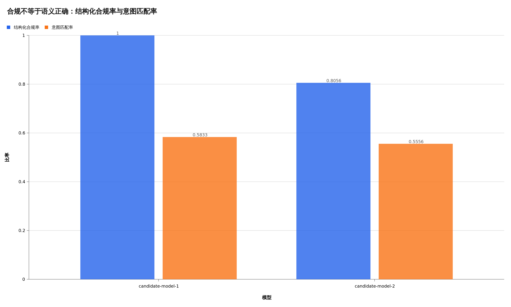
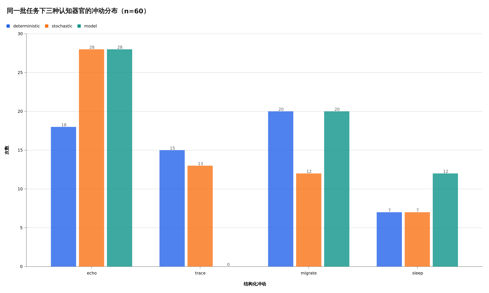
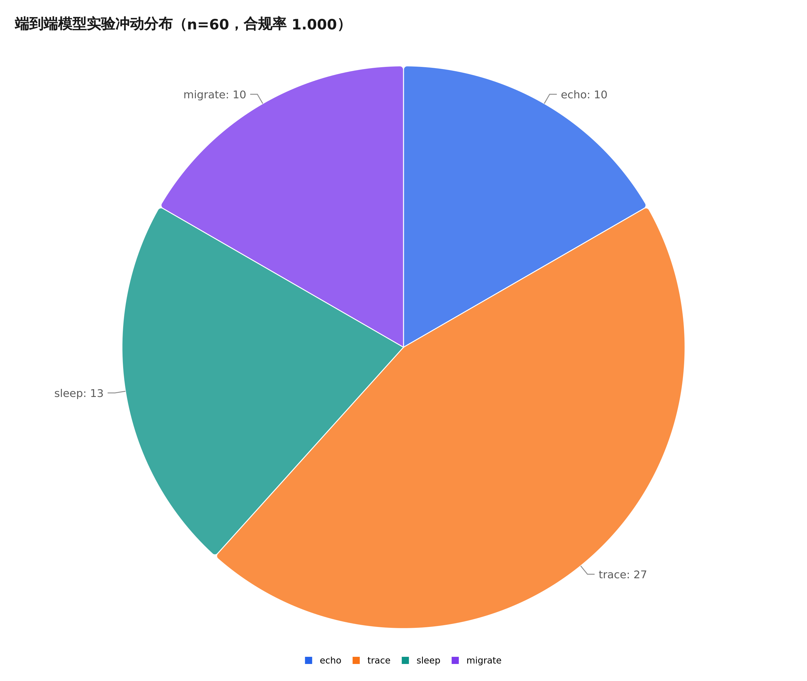
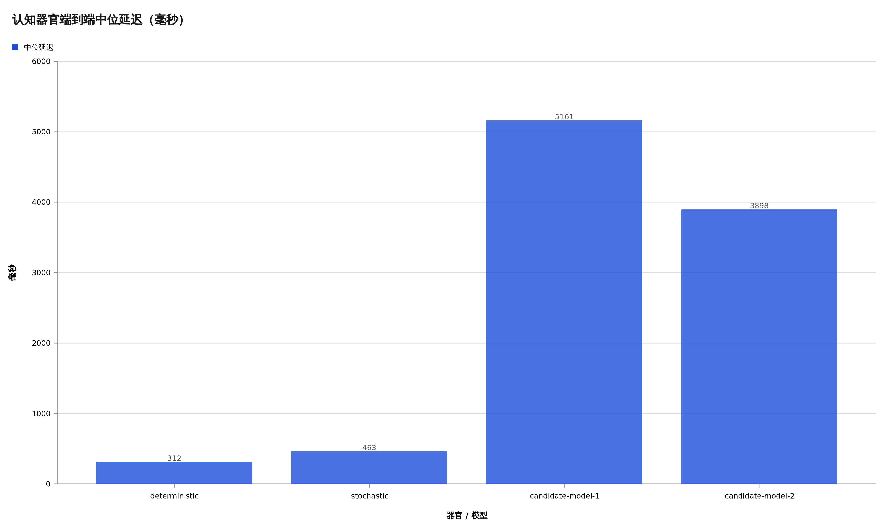
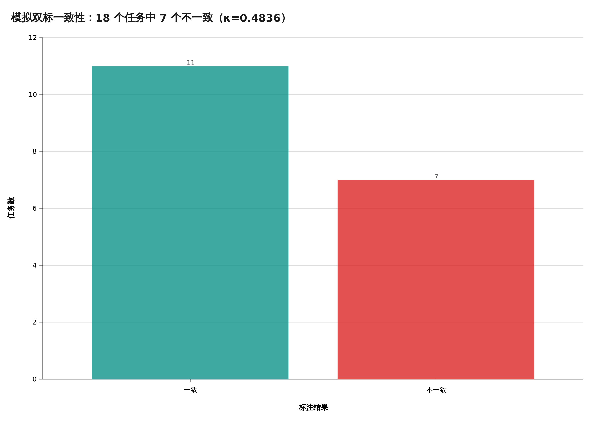

# 模型器官稳定性与默认选择报告

日期：2026-11-15（Asia/Shanghai）

## 实验设计

- 18 个任务，每个任务预注册一个意图：`echo / trace / migrate / sleep`
- 4 轮 × 18 任务 × 2 模型 = 144 次真实端到端调用
- 路径：生产 `nna wake --cognition model`
- 模型：`candidate-model-1`、`candidate-model-2`
- 原始数据：`evidence/model-stability/report.json`

## 结果

| 模型 | 合规 | 合规率 | Wilson 95% | 意图匹配 | 中位延迟 | p95 |
| --- | ---: | ---: | --- | ---: | ---: | ---: |
| `candidate-model-1` | 72/72 | 1.000 | [0.9493, 1] | 0.5833 | 5161 ms | 6705 ms |
| `candidate-model-2` | 58/72 | 0.806 | [0.6997, 0.8805] | 0.5556 | 3898 ms | 6123 ms |

两者 replay 全部有效，密钥泄露为 0。

## 关键结论

- **合规 ≠ 意图正确**：`candidate-model-1` 能稳定输出合法四选一单词，但只有 58.3% 与预注册意图一致。
- **candidate-model-2 不稳定**：14 次失败，合规率 80.6%，不能作为默认器官。
- **因此不切换默认认知器官**：默认仍为 `deterministic`。`candidate-model-1` 只能作为“结构化契约可用、语义意图未验证”的候选。

## 失败模式

`candidate-model-1` 在 `calm`、`conflict`、`late`、`urgent`、`mobility2` 等任务上 0% 意图匹配，说明它对语义的理解与预注册意图不一致，而不是输出格式错误。

## 基线对照

同一 18 任务、同一 4 轮的离线基线：

| 器官 | 合规 | 意图匹配 | 中位延迟 |
| --- | ---: | ---: | ---: |
| deterministic | 72/72 | 0.1944 | 312 ms |
| stochastic | 72/72 | 0.2639 | 463 ms |

这说明意图标签并不可靠：哈希型适配器不具备语义能力，却能被用来“比较”模型。因此意图匹配率不能作为模型能力排序依据。

## 标注状态

本轮 18 个任务是单人、未验证的预注册标签。审计显示 4 个任务存在多义线索冲突、5 个任务的标签与文本线索不一致。因此在独立盲标与一致性检验完成前，意图匹配率不能用于模型排名。协议见 `ANNOTATION_PROTOCOL.md`，证据见 `evidence/annotation/`。

## 决策

见 `DECISIONS.md` ADR-017、ADR-018 与 ADR-019：默认认知器官保持 `deterministic`；意图匹配率只作为任务标签可分性指标，不用于模型能力排序。
