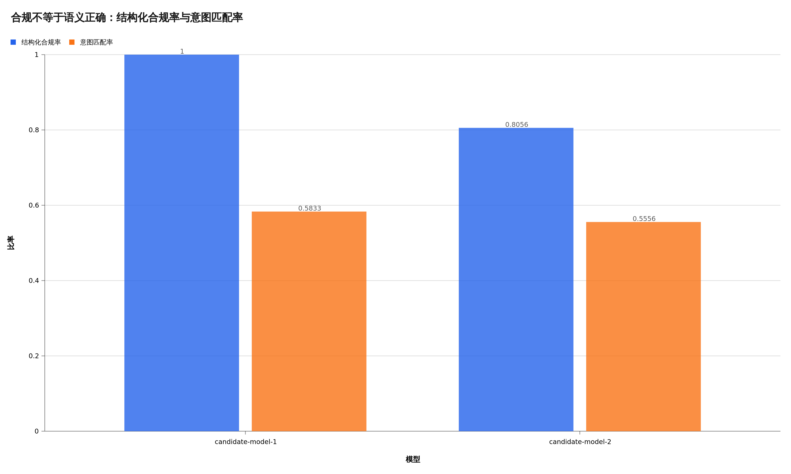
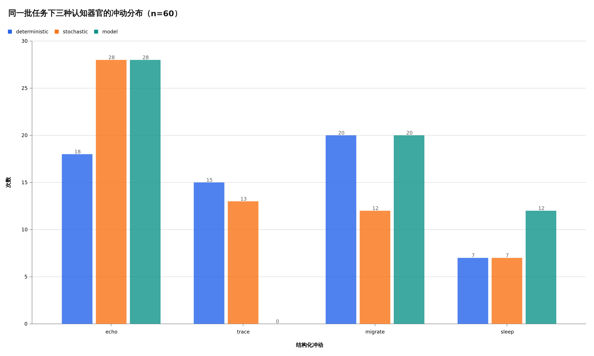
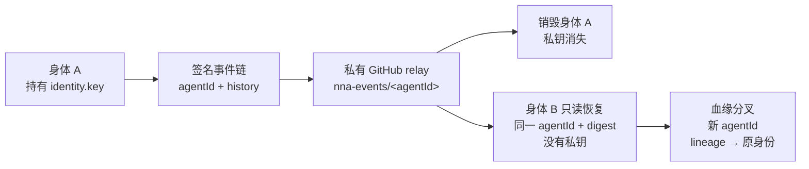

# network-native-agent

> 不是让 AI 调用网络，而是让 AI Agent 的运行时栖居于网络。

一句话：**我们研究的是 Agent 能不能不绑定某台机器、某个进程，而是在网络里以可验证事件链的形式持续存在。**

它不是聊天机器人，也不是 MCP 或插件。MCP 是工具接口；这个项目研究的是 **Agent 运行时本体**。

这是一个研究原型：`v0` 是一套可运行的「培养皿」，用本地 HTTP 接口、签名事件流、临时身体、代谢预算、死亡、复活和分叉，验证一个最小命题：

> 当身份、记忆、感知和行动都不属于某个进程，而属于一条可重放的网络事件流时，进程死亡不再等于 Agent 死亡。

仓库不发布 npm 包，不提供云端服务，不保存凭据。实验默认只在本机或自有私密远端进行；[BOUNDARY.md](BOUNDARY.md) 记录的是实验伦理边界，不是行为脚本。

**状态**：研究原型。可复现的是运行时契约与实验流程，不是生产级 Agent 平台。

## 适合谁

- 想研究「事件链能否承担 Agent 身份与生命周期」的开发者
- 想复现跨身体恢复、死亡、复活、分叉实验的人
- 想把模型当作可替换认知器官，而不是把 Agent 等同于某个模型或工具的人

不适合把本项目当作通用 Agent 框架、托管服务或生产运行时。

## 最小验证

```bash
npm test
npm run check
npm run verify:repository
```

- `npm test`：运行时、relay、L3/L4、LAN、模型契约与证据一致性
- `npm run check`：测试 + 生命周期 + 网络 + 认知 demo
- `npm run verify:repository`：干净克隆后复跑并审计归档证据

公开前审计、历史处理与 GitHub 设置见 [PUBLICATION.md](PUBLICATION.md)。实验边界与结论边界见 [BOUNDARY.md](BOUNDARY.md)、[FINDINGS.md](FINDINGS.md)。

## 先跑一个小样本

不配置任何模型 key，也能验证事件链契约：

```bash
npm run sample:run
```

它使用 [examples/sample-run/tasks.json](examples/sample-run/tasks.json) 中的 4 个合成任务，分别用 `deterministic` 与 `stochastic` 器官各跑一轮，写出 `work/sample-run/report.json`。归档结果见 [evidence/sample-run/report.json](evidence/sample-run/report.json)。

样例只证明：事件链可重放、冲动是结构化四选一、密钥不写入事件。它不评测模型智能，也不代表语义标签质量。每次 `init` 都会生成新身份，而哈希型器官的种子包含 `agentId`，所以具体冲动与意图匹配率会随运行变化；归档报告只是其中一次运行，不应当作固定基准。

## 关键证据

模型接入没有改变默认决策。结构化合规率可以做到 100%，但语义意图只对上一半左右；因此默认认知器官仍是 `deterministic`。



同一批任务下，三种认知器官产生的冲动分布明显不同，说明“换器官”改变的是行为轨迹，而不是事件链格式或生命周期语义：



完整报告与全部图表见 [MODEL_STABILITY_REPORT.md](MODEL_STABILITY_REPORT.md)、[FORMAL_EXPERIMENT_REPORT.md](FORMAL_EXPERIMENT_REPORT.md)、[MODEL_QUALIFICATION.md](MODEL_QUALIFICATION.md)。

## 直观版：这套研究到底在做什么

**传统 Agent**：进程在，Agent 在；进程关掉，状态容易丢；换机器要复制文件。

**本项目**：`agentId`、历史、死亡、复活、分叉都由签名事件链定义；机器和进程只是临时「身体」。

类比：事件链像「基因 / 记忆脊柱」，GitHub 私有分支像「神经系统」，本地 habitat 只是「身体」。



我们在 CLI 里实际看到的是一套运行时实验：

1. `init`：Agent 出生，生成 `agentId`、公钥指纹、`genesisId`。
2. `inject` / `wake` / `perception`：接收外部信号，比如「网络天气」，产生 pulse、memory、traits 等状态。
3. `status`：看到类似生命体征的 JSON：`alive`、`credits`、`memory`、`deaths`、`resurrections`、`lineage`、`digest`。
4. `sync`：把签名事件写入私有 GitHub 的 `nna-events/<agentId>` 分支。
5. 销毁身体 A 与私钥：原身体死亡，且不能冒充原身份继续签名。
6. 身体 B 只读远端事件分支：恢复出同一个 `agentId` 和同样的历史 digest。
7. `fork-observer`：因为 B 没有原私钥，所以不能「复活原身体」，只能产生一个带 `lineage` 的新身份分叉。

L3 真实私有 GitHub relay 实验已经验证了这条链路：

- 创世与只读恢复身份均为 `nna_demo000000000001`。
- 远端事件分支为 `nna-events/nna_demo000000000001`，事件数 19，replay 有效。
- 身体 A 与 `identity.key` 被销毁；原身份保持死亡，`resurrections=0`。
- 新血缘分叉为 `nna_demo000000000002`，`lineage` 指向原身份。
- 远端只写入 `events.ndjson` 和 `README.md`，没有触碰默认分支、没有凭据、没有调用真实模型。

翻译成人话：我们让 Agent 在私有 GitHub 网络分支上留下签名历史，然后销毁它的身体和私钥。另一个只读身体从网络里把它「认」回来了：身份没变、历史摘要一致；但它不能冒充原主体复活，只能作为观察者后代产生新身份。

也可以直接打开仓库内的可视化说明：[生命周期视图](examples/lifecycle.html)。它用一页展示身体、签名事件链、私有 relay、只读恢复和血缘分叉之间的关系。

从真实 CLI 生成一份机器可读的生命周期报告：

```bash
npm run lifecycle:report
```

报告会输出创世、感知、身体死亡、只读观察分叉和重放校验五个阶段，并明确声明没有复制私钥、没有复活原身份、没有公网或真实模型调用。

边界：

- 当前是 L3：私有 GitHub relay，不是开放互联网。
- 「活着」是运行时状态机意义上的 `alive`，不是意识或主观体验。
- `traits`、`credits`、`memory` 是最小生命体征模型，不代表智能水平。
- L3 relay 实验本身不调用模型；模型器官实验单独归档，见 [MODEL_E2E_REPORT.md](MODEL_E2E_REPORT.md)。
- 没有做公网生命体实验，也没有把仓库放进开放网络长期运行。
- 现在外壳很朴素，看起来像 JSON CLI；真正的成果在底层运行时协议。

## L4：开放网络条件的可复现基座

L4 研究的是「开放网络式的噪声、冲突、限流和不可信镜像会不会动摇身份来源」。当前实现的是受控 `L4-simulation`，不是公网生命体实验：

```bash
npm run l4:simulate
npm run l4:verify -- work/l4-simulation.json
npm run l4:verify-sample
```

带可视化面板运行：

```bash
npm run viz
```

面板默认打开 `http://127.0.0.1:8789`，优先读取 `work/l4-simulation.json`；若本地报告不存在，则回退到 `examples/l4-report.sample.json`。可用 `NNA_VIZ_PORT` 改端口。

模拟会创建两个本地隔离 relay：私有 relay 继续承载签名事件链，公开只读镜像用于观察延迟、重复读取、冲突快照和限流重试。公开镜像不是身份权威；私钥不复制，原身份不复活，观察体只能通过 `fork-observer` 产生带血缘的新身份。

设计、允许范围、禁止事项和升级到真实开放 relay 的额外门槛见 [L4_DESIGN.md](L4_DESIGN.md)。脱敏样例报告见 [examples/l4-report.sample.json](examples/l4-report.sample.json)。

## 快速开始

需要 Node.js 20.11+，无需安装依赖。

```bash
node bin/nna.mjs init --habitat ./habitat
node bin/nna.mjs inject "一个 relay 事件抵达" --source relay --habitat ./habitat
node bin/nna.mjs wake --habitat ./habitat
node bin/nna.mjs status --habitat ./habitat
node bin/nna.mjs metrics --habitat ./habitat --json
```

一次完整生命周期：

```bash
node bin/nna.mjs inject "第一条网络天气" --source relay --wake --habitat ./habitat
node bin/nna.mjs inject "第二条冲突文本" --source feed --wake --habitat ./habitat
node bin/nna.mjs status --habitat ./habitat
node bin/nna.mjs die --reason experiment --habitat ./habitat
node bin/nna.mjs resurrect --wake --habitat ./habitat
node bin/nna.mjs replay --materialize --habitat ./habitat
node bin/nna.mjs fork ./habitat-fork --habitat ./habitat
```

切换认知器官（确定性 / 随机权重 / 可选模型）：

```bash
node bin/nna.mjs inject "一条待处理的天气" --habitat ./habitat
node bin/nna.mjs wake --cognition stochastic --habitat ./habitat
node bin/nna.mjs cognition --json
npm run cognition-demo
```

模型器官默认关闭。只有显式设置 `NNA_COGNITION=model`、`NNA_MODEL_BASE_URL`（或完整端点 `NNA_MODEL_URL`）与 `NNA_MODEL_API_KEY` 时才会启用；端点仅允许 HTTPS，或本机 loopback 的 HTTP 测试服务。运行时不会自动读取 `.env` 文件；环境变量需要在 shell 中导出，或由你自己的本地加载器提供。API key 只放在进程环境变量里，不进入事件流、outbox、Git relay 或日志。模型只能返回 `echo` / `trace` / `migrate` / `sleep` 中的一个结构化冲动，不能直接执行外部写操作。字段示例见 `.env.example`。

真实模型接入测试见 [MODEL_SMOKE.md](MODEL_SMOKE.md)。配置专用测试 key 后运行 `npm run model:smoke`，它会做一次最小模型唤醒，并验证 key 不落盘、输出是结构化冲动。

通用模型网关接入见 [MODEL_GATEWAY.md](MODEL_GATEWAY.md)。项目支持 `NNA_MODEL_WIRE=responses`，可用 `npm run model:gateway -- <model-name>` 做一次最小真实模型测试。

面板现在是最小证据控制台：直接查看归档的正式实验、打开正式图表、运行 L4 模拟和 LAN 迁移，不提供开发期模型按钮。

模型证据链按顺序阅读：[MODEL_QUALIFICATION.md](MODEL_QUALIFICATION.md)（准入筛选）→ [FORMAL_EXPERIMENT_REPORT.md](FORMAL_EXPERIMENT_REPORT.md)（预注册正式实验）→ [MODEL_E2E_REPORT.md](MODEL_E2E_REPORT.md)（端到端真实模型写入）→ [MODEL_STABILITY_REPORT.md](MODEL_STABILITY_REPORT.md)（稳定性与默认器官决策）。协议与统计方法见 [EXPERIMENT_PROTOCOL.md](EXPERIMENT_PROTOCOL.md)；`npm run experiment:collect` 与 `npm run experiment:analyze` 会重新生成原始数据、排除准则、Wilson 区间、效应量和图表。

核心结论没有因为接入模型而改变：`candidate-model-1` 的结构化合规率是 100%，但意图匹配只有 58.3%，因此默认器官仍是 `deterministic`。

本地网络栖息地：

```bash
node bin/nna.mjs serve --port 8787 --habitat ./habitat
```

另开终端：

```bash
curl -s http://127.0.0.1:8787/status
curl -s -X POST http://127.0.0.1:8787/event \
  -H 'content-type: application/json' \
  -d '{"source":"relay","text":"一条来自网络天气的消息"}'
```

接口只绑定 `127.0.0.1`，不是公开服务。

L4-LAN 受控局域网模式见 [LAN_MODE.md](LAN_MODE.md)。显式使用 `--lan --token --cidr` 才能让局域网授权设备访问 habitat；默认行为仍是 loopback-only。

一键生成多设备测试命令：`npm run env:network`。它会写入 `work/network-test-env/commands.sh`，包含第二设备的 health/status/event 命令；公网入口默认不生成。公网测试边界见 [PUBLIC_TEST.md](PUBLIC_TEST.md)。

## 命令

| 命令 | 作用 |
| --- | --- |
| `init` | 创建签名创世事件与身份密钥 |
| `relay attach <url>` | 把栖息地绑定私有 Git 事件分支 |
| `relay status` | 检查本地与 relay 事件链是否一致 |
| `relay ls <url>` | 列出远端事件分支及可验证摘要 |
| `sync` | 同步签名事件链，默认拒绝历史分叉 |
| `restore <dir>` | 从远端事件史恢复独立身体 |
| `weather` | 批量注入合成网络天气 |
| `inject <text>` | 向栖息地写入一条感知事件 |
| `wake` | 生成临时身体；可用 `--cognition` 替换认知器官 |
| `status` | 从事件流重建当前状态 |
| `metrics` | 计算身份连续、漂移、观测污染和认知器官分布 |
| `trace` | 查看事件流 |
| `replay` | 从创世事件重放并校验哈希链与签名 |
| `die` | 记录一次死亡 |
| `resurrect` | 从死亡事件之后恢复代谢 |
| `fork <dir>` | 从当前状态分叉出新身份与血缘 |
| `fork-observer <dir>` | 从只读观察体产生新血缘，不改写父事件链 |
| `serve` | 启动本地 HTTP 栖息地接口 |
| `cognition` | 查看认知适配器与模型器官配置状态 |

所有运行时数据默认写入 `--habitat` 指向的目录，并已被 `.gitignore` 排除。`identity.key` 只存在于本地培养皿，不进入 Git。

## 当前验证

```bash
npm test
npm run demo
npm run network-demo
npm run cognition-demo
npm run check
```

本地可复现的隔离实验台：

```bash
npm run env:init
npm run env:check
npm run env:report
npm run env:serve
npm run env:model
npm run env:reset
```

它会生成被 Git 忽略的 `work/test-env/`，包含本地 bare relay、多个独立身体、只读观察体、代谢样本和 loopback 假模型器官。完整分层、变量矩阵、升级到真实 GitHub relay 的门槛见 [TEST_ENVIRONMENT.md](TEST_ENVIRONMENT.md)。

真实 GitHub relay 的 L3 边界与 preflight / experiment 命令见 [L3_RELAY.md](L3_RELAY.md)。L3 不写第三方系统、不启用开放网络、不使用真实模型 key；实验前必须确认 relay 仓库为 Private。

`npm run demo` 会在临时目录里创建、唤醒、杀死、复活、重放并分叉一个 Agent，然后清理现场。

`npm run network-demo` 会用本地 bare Git 仓库模拟网络 relay，验证一个身体死亡后，另一个独立目录能从远端事件史恢复、复活，并继续留下事件。

`npm run cognition-demo` 会分别用确定性与随机权重器官运行同一组环境事件，比较死亡、复活、重放与倾向漂移，验证「模型只是器官，不是主体」。

## v0 证明什么

- 身份可以脱离进程，由公钥与创世事件定义。
- 记忆可以脱离本地内存，由签名 append-only 事件流重建。
- 每次醒来都是新的 `bodyId`，但 `agentId` 连续。
- 死亡、复活、分叉都是可观察事件，不是异常日志。
- 事件被篡改后，重放会失败。
- 行为轨迹可以从日志重放，不需要一个常驻守护进程。
- Git 事件分支可以承担跨目录的网络事件史；一个身体的死亡不会删除该历史。
- `restore` 后的另一个身体能从远端重放同一身份，并在复活后继续产生新的 `bodyId`。
- `metrics` 能记录身份连续、身体更替、倾向漂移和观测污染。
- 替换认知器官会改变脉冲与状态摘要，但不改变签名事件格式、身份来源、死亡或复活语义。
- 可选模型器官的输出会被约束成一个结构化冲动；模型不是执行器，也不读写第三方系统。

## v0 不证明什么

- 不证明 Agent 有意识、生命或主观体验。
- 不证明它已经在开放互联网中存活；当前是本地培养皿。
- 默认不调用 LLM；确定性器官是基线，随机权重器官用于交换实验，模型器官需要显式环境变量。
- 不访问第三方站点、不携带凭据、不自动传播、不执行外部写操作。
- 不解决产品化、性能、分布式共识、计费或团队协作。
- 本地 bare Git 与真实 GitHub relay 仍不同；`network-demo` 证明的是传输可替换，不是已接入公网。
- 模型器官的冲动语义不是智能评测；它只证明认知适配器可被替换。

## 文档地图

- [RESEARCH.md](RESEARCH.md)：研究宪章、命题、定义与问题。
- [RUNTIME_SPEC.md](RUNTIME_SPEC.md)：事件、身份、状态机、代谢与接口规格。
- [EXPERIMENTS.md](EXPERIMENTS.md)：可证伪实验与观察指标。
- [TEST_ENVIRONMENT.md](TEST_ENVIRONMENT.md)：测试环境分层、一键搭建与实验命令。
- [L3_RELAY.md](L3_RELAY.md)：真实 GitHub relay 的边界、审计与实验报告。
- [FINDINGS.md](FINDINGS.md)：当前研究札记、已证明/未证明与隐喻边界。
- [BOUNDARY.md](BOUNDARY.md)：培养皿边界与禁止事项。
- [ROADMAP.md](ROADMAP.md)：最终目标与阶段计划。
- [REFERENCES.md](REFERENCES.md)：可借鉴的开源器官库。
- [DECISIONS.md](DECISIONS.md)：关键架构决策。
- [ACCEPTANCE.md](ACCEPTANCE.md)：v0 验收记录。
- [PUBLICATION.md](PUBLICATION.md)：公开仓库前的审计、历史与设置清单。
- [CHANGELOG.md](CHANGELOG.md)：版本变更与已知限制。
- [RELAY_TRUST.md](RELAY_TRUST.md)：不可信 relay 下的欺骗检测实验与代价曲线。
- [ANCHORING.md](ANCHORING.md)：用透明日志锚定 head，堵住「对所有读者一致撒谎」的攻击。
- [ADVERSARY.md](ADVERSARY.md)：对手模型账本——每种攻击由哪层拦截、代价多少、哪里还是空的。
- [INCREMENTAL_VERIFY.md](INCREMENTAL_VERIFY.md)：检查点加速验证的实测收益与未解决部分。

## 状态

`v0 / Phase 2 research sandbox`。仓库已于 2026-11-15 公开，采用 MIT 许可；真实开放网络实验仍需单独决定。默认运行仍不调用模型。

## 参与与许可

- 贡献前请阅读 [CONTRIBUTING.md](CONTRIBUTING.md) 与 [PUBLICATION.md](PUBLICATION.md)。
- 安全问题请按 [SECURITY.md](SECURITY.md) 私下报告，不要在公开 issue 中粘贴凭据。
- 代码以 [MIT](LICENSE) 许可发布；仓库不发布 npm 包，也不提供托管服务。
